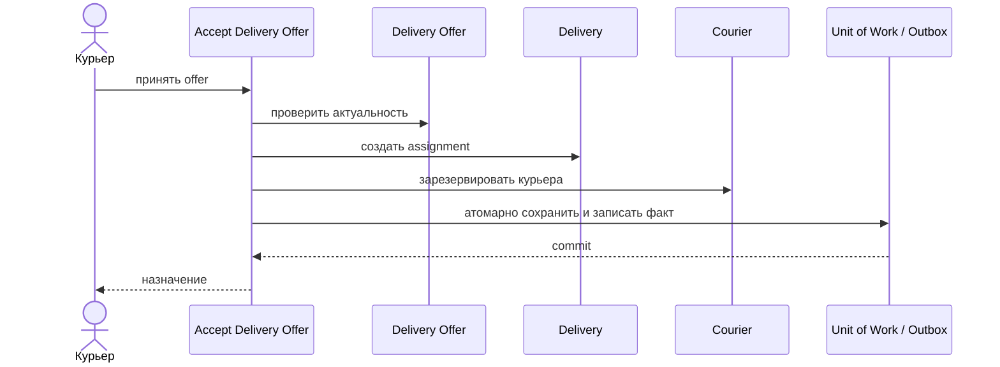

# Accept Delivery Offer

## Сценарий

- **Тип:** Command.
- **Actor:** Курьер.
- **Намерение:** Принять актуальное предложение доставки.
- **Результат:** Ровно один актуальный offer превращён в `Courier Assignment`; курьер и доставка зарезервированы.

## Границы

- **Владелец:** `delivery/slices/delivery`.
- **Домен:** `domains/delivery`.
- **Взаимодействие:** Конкурентное принятие защищается доменным инвариантом и атомарной записью; результат записывается в Outbox.

## Последовательность

## Реализация

- **Handler:** `mod.rs` — `Input`, `Output`, `Handler::execute(subject, input)`; требования FR-309, FR-310.
- **Порты:** `DeliveryAuthorization` (`AcceptDeliveryOffer` над `Courier(id)`), `UnitOfWork`, `DeliveryOfferRepository`, `OffersOfDelivery` (id offers доставки для отзыва остальных; каждый загружается через репозиторий), `DeliveryRepository`, `CourierAssignment` (порт слайса `courier`), `DeliveryOutbox`, `CourierLocator`, `Clock`, `AssignmentPolicy`.
- **Транзакция:** UoW: offer + остальные pending offers (`withdrawn`) + `Delivery` + `Courier` + Outbox (`CourierAssignedToDelivery`); snapshot курьера и `now` получаются до транзакции. Повтор принятия тем же курьером — no-op без второго факта.
- **Допущение:** Конкурентное принятие защищается unique constraint и версией в PostgreSQL.

## Acceptance

BDD-сценарии размещаются в `acceptance/accept_delivery_offer.feature` после утверждения acceptance criteria в SDD.

Общий каталог: [Delivery use cases](../../../../README.md#use-cases).

