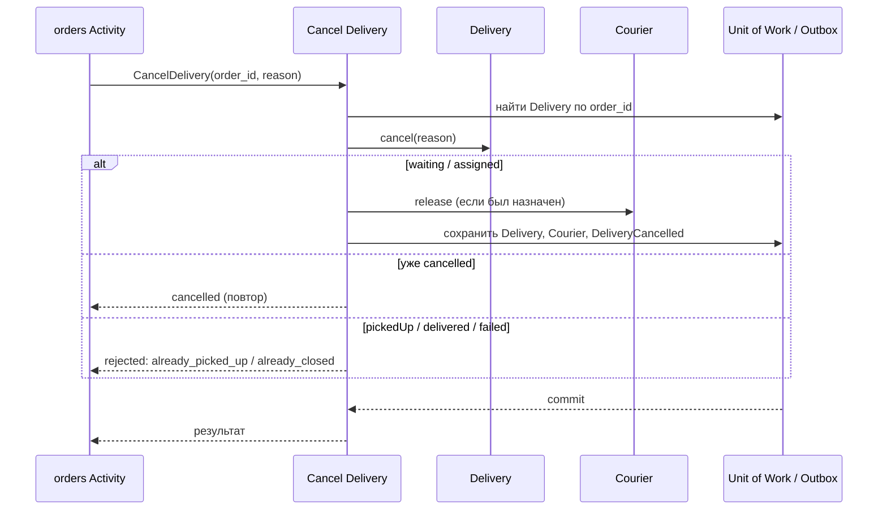

# Cancel Delivery

## Сценарий

- **Тип:** Command.
- **Actor:** Fulfillment process `orders` (Temporal Activity, service identity `orders-worker`).
- **Намерение:** Отменить доставку заказа, пока заказ не забран у ресторана.
- **Результат:** `Delivery` в `cancelled`, назначенный курьер освобождён; либо бизнес-отказ с причиной.

## Границы

- **Владелец:** `delivery/slices/delivery`.
- **Домен:** `domains/delivery` (FSM: `Waiting`/`Assigned` + `Cancel` → `Cancelled`).
- **Взаимодействие:** gRPC `CancelDelivery`, адресуется `order_id`; используется как компенсация в Order Fulfillment Workflow.

## Последовательность

## Реализация

- **Handler:** `mod.rs` — `Input { order_id, reason }`, `Output { delivery_id, outcome }`, `Outcome::Cancelled { released_courier_id, already_cancelled }` | `Outcome::Rejected(CancellationRejection)`; требования FR-429.
- **Порты:** `DeliveryAuthorization` (`CancelDelivery` над `Order(order_id)`), `UnitOfWork`, `DeliveryRepository` (`find_by_order`), `CourierAssignment` (порт слайса `courier`), `DeliveryOutbox`.
- **Транзакция:** UoW: `Delivery` (`waiting|assigned → cancelled`) + освобождение `Courier` и DELETE `delivery#courier` до commit (`release_assignment`, FR-444, FR-447) + Outbox (`DeliveryCancelled`).
- **Ошибки:** пустой `order_id` — `InvalidRequest`; нет доставки для заказа — `DeliveryForOrderNotFound`; отказ прав — `PermissionDenied`.
- **Допущения:** `reason` необязателен (пустой — без причины) и публикуется только в событии, не хранится в `Delivery`; отказ по состоянию — успешный ответ, не ошибка.

## Acceptance

- AC-455 — отмена назначенной доставки: `cancelled`, курьер освобождён, повтор — успех.
- AC-456 — отмена после Pickup: `cancelled = false`, `rejection_reason = already_picked_up`.

Общий каталог: [Delivery use cases](../../../../README.md#use-cases).
