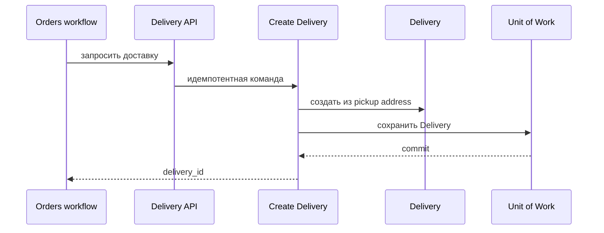

# Create Delivery

## Сценарий

- **Тип:** Command.
- **Actor:** Fulfillment process `orders`.
- **Намерение:** Запросить доставку оформленного заказа.
- **Результат:** Идемпотентно создана `Delivery` с pickup-адресом ресторана и данными контекста.

## Границы

- **Владелец:** `delivery/slices/delivery`.
- **Домен:** `domains/delivery`.
- **Взаимодействие:** Вызывается Temporal Activity через API `delivery`.

## Последовательность

## Реализация

- **Handler:** `mod.rs` — `Input`, `Output`, `Handler::execute(subject, input)`; требования FR-306.
- **Порты:** `DeliveryAuthorization` (`CreateDelivery` над `Platform`), `DeliveryRepository`, `IdGenerator`.
- **Транзакция:** Без UoW: ключ идемпотентности — `OrderId` (уникальность в репозитории); совпадающий повтор возвращает существующую `Delivery`, конфликтующий — `DeliveryAlreadyExists`.
- **Допущение:** Find Courier здесь не запускается: поиск курьера начинает следующий проход Dispatch Deliveries (FR-582).

## Acceptance

BDD-сценарии размещаются в `acceptance/create_delivery.feature` после утверждения acceptance criteria в SDD.

Общий каталог: [Delivery use cases](../../../../README.md#use-cases).

