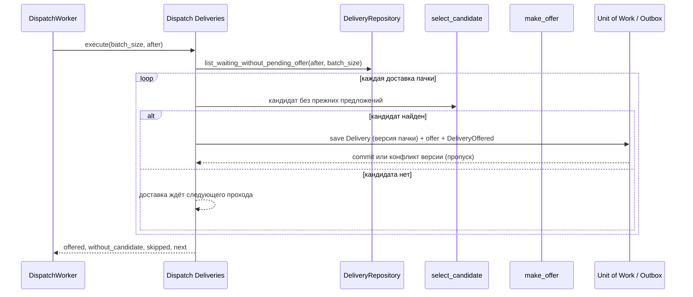

# Dispatch Deliveries

## Сценарий

- **Тип:** Command (фоновая задача).
- **Actor:** Процесс `delivery` по расписанию (`DispatchWorker`).
- **Намерение:** Начать поиск курьера для ожидающих доставок: сразу после Create Delivery и снова после отказа или истечения предложения.
- **Результат:** Ожидающей `Delivery` без pending offer предложена доставка курьеру, которому её ещё не предлагали; без кандидата доставка остаётся ожидающей до следующего прохода.

## Границы

- **Владелец:** `delivery/slices/delivery`.
- **Домен:** `domains/delivery` — `Delivery` (`ensure_assignable`) и `DeliveryOffer` (`DeliveryOffered`).
- **Взаимодействие:** Шаги — application services Find Courier (`select_candidate`: исключает курьеров, которым доставку уже предлагали) и Offer Delivery (`make_offer`). Внутренний Domain Event `DeliveryOffered` пишется в Outbox и не публикуется. Replan Delivery из `orders` по deadline назначения остаётся эскалацией.

## Последовательность

## Реализация

- **Handler:** `mod.rs` — `Input { batch_size, after }`, `Output { offered, without_candidate, skipped, next }`, `Handler::execute(input)`; требование FR-582. Subject и проверки прав нет — задачу запускает сам процесс.
- **Порты:** `UnitOfWork`, `DeliveryRepository` (`list_waiting_without_pending_offer`: `waiting` без pending offer, по `(created_at, id)` после `after`, не больше `limit`; `Delivery` без `created_at` считается созданной в `0`), `CourierAssignment`, `DeliveryOfferRepository`, `DeliveryOutbox`, `CourierLocator`, `IdGenerator`, `Clock`, `AssignmentPolicy`.
- **Транзакция:** UoW на каждую доставку: `Delivery` сохраняется с версией из пачки до создания offer, поэтому конкурентное изменение — другой dispatcher, принятое предложение, Replan или Cancel — optimistic-concurrency конфликт и пропуск, не ошибка. Курьер, переставший быть доступным после выбора, — тоже пропуск. Ошибка зависимости (locator, хранилище) прерывает пачку.
- **Расписание:** `DispatchWorker` (`di/dispatch_worker.rs`) каждые `OFFERS__DISPATCH_INTERVAL` (по умолчанию `2s`) проходит все ожидающие доставки пачками по `OFFERS__DISPATCH_BATCH` (по умолчанию `100`), продолжая с `next` предыдущей пачки, поэтому доставки без кандидата не загораживают следующие; останавливается по сигналу shutdown основного worker.
- **Допущение:** Курьер выбирается правилом Find Courier над текущим locator (сохранённые позиции, без расстояния). Когда всем доступным курьерам доставку уже предлагали, она ждёт Replan Delivery.

## Acceptance

AC-734 (предложение после создания), AC-735 (повтор после отказа или истечения), AC-736 (нет свободных курьеров) — `tests.rs`; конкурентные dispatcher'ы над PostgreSQL — `tests/postgres_assignment.rs`.

Общий каталог: [Delivery use cases](../../../../README.md#use-cases).
