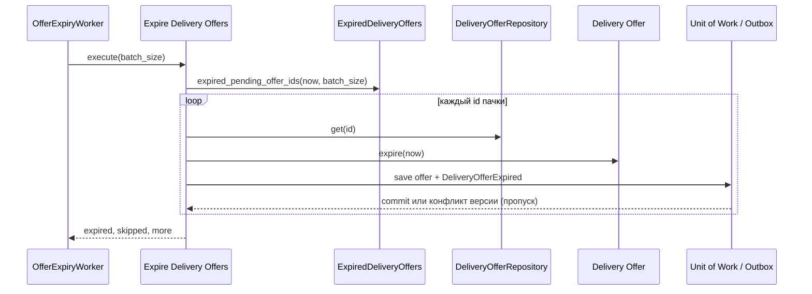

# Expire Delivery Offers

## Сценарий

- **Тип:** Command (фоновая задача).
- **Actor:** Процесс `delivery` по расписанию (`OfferExpiryWorker`).
- **Намерение:** Закрыть pending offers, на которые адресат не ответил до `expiresAt`.
- **Результат:** Offers с `expiresAt < now` переведены в `expired`; `Courier Assignment` не создаётся. Повторный поиск начинает следующий проход Dispatch Deliveries.

## Границы

- **Владелец:** `delivery/slices/delivery`.
- **Домен:** `domains/delivery` — переход `Expire` агрегата `DeliveryOffer` (только из `pending` и только при `now > expiresAt`).
- **Взаимодействие:** Внутренний Domain Event `DeliveryOfferExpired` пишется в Outbox, не публикуется, считается метрикой `nomnom.delivery.offers{nomnom.outcome="expired"}`.

## Последовательность

## Реализация

- **Handler:** `mod.rs` — `Input { batch_size }`, `Output { expired, skipped, more }`, `Handler::execute(input)`; subject и проверки прав нет — задачу запускает сам процесс.
- **Порты:** `UnitOfWork`, `ExpiredDeliveryOffers` (query-порт рядом с use case, `expired_pending_offer_ids`: id pending offers с `expires_at < now`, по `expires_at`, не больше `limit`; реализует `PostgresStore`), `DeliveryOfferRepository` (`get`/`save` каждого offer), `DeliveryOutbox`, `Clock`.
- **Транзакция:** UoW на каждый offer: offer (`expired`) + Outbox (`DeliveryOfferExpired`). Optimistic-concurrency конфликт — offer конкурентно принят, отклонён или отозван — пропуск, не ошибка; повторный запуск идемпотентен (уже `expired` offers не выбираются).
- **Расписание:** `OfferExpiryWorker` (`di/offer_expiry_worker.rs`) каждые `OFFERS__EXPIRY_INTERVAL` (по умолчанию `15s`) читает пачки по `OFFERS__EXPIRY_BATCH` (по умолчанию `100`), пока `more`; останавливается по сигналу shutdown основного worker.
- **Допущение:** Повторное предложение другому курьеру не делается здесь: истёкший offer больше не pending, и доставку предлагает следующему курьеру Dispatch Deliveries; `ReplanDelivery` из `orders` по deadline назначения остаётся эскалацией.

## Acceptance

BDD-сценарии размещаются в `acceptance/expire_delivery_offers.feature` после утверждения acceptance criteria в SDD.

Общий каталог: [Delivery use cases](../../../../README.md#use-cases).
