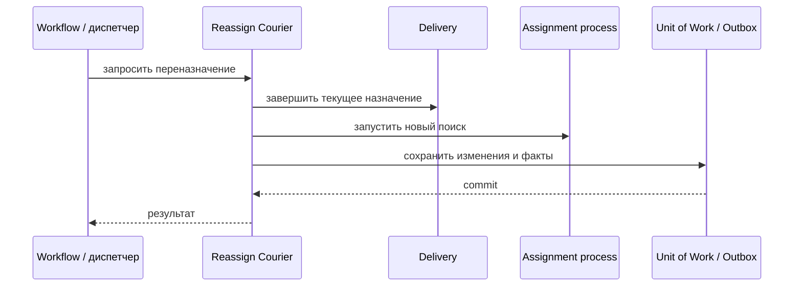

# Reassign Courier

## Сценарий

- **Тип:** Command.
- **Actor:** Процесс назначения `delivery` или авторизованный диспетчер.
- **Намерение:** Прекратить неактуальное назначение и подобрать замену.
- **Результат:** Текущее назначение отменено или истекло; доставка снова участвует в поиске.

## Границы

- **Владелец:** `delivery/slices/delivery`.
- **Домен:** `domains/delivery`.
- **Взаимодействие:** Может вызываться Temporal Activity; алгоритм повторного выбора принадлежит `delivery`.

## Последовательность

## Реализация

- **Handler:** `mod.rs` — `Input`, `Output`, `Handler::execute(subject, input)`; требования FR-312.
- **Порты:** `DeliveryAuthorization` (`ReassignCourier` над `Delivery(id)`), `UnitOfWork`, `DeliveryRepository`, `CourierRepository`, `DeliveryOutbox`.
- **Транзакция:** UoW: `Delivery` (`assigned → waiting`) + освобождение `Courier` + Outbox (`CourierUnassignedFromDelivery`).
- **Допущение:** Переназначение после Pickup запрещено; поиск замены запускает вызывающий процесс.

## Acceptance

BDD-сценарии размещаются в `acceptance/reassign_courier.feature` после утверждения acceptance criteria в SDD.

Общий каталог: [Delivery use cases](../../../../README.md#use-cases).

