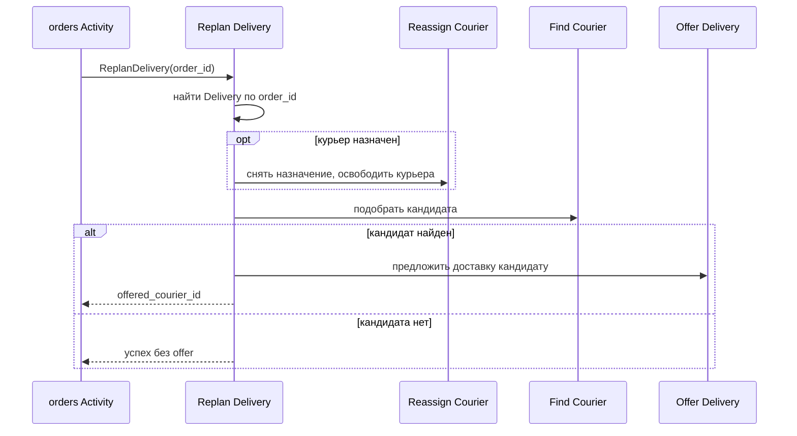

# Replan Delivery

## Сценарий

- **Тип:** Command.
- **Actor:** Fulfillment process `orders` (Temporal Activity, service identity `orders-worker`).
- **Намерение:** Перепланировать доставку заказа: снять неактуального курьера и предложить доставку новому.
- **Результат:** Доставка в поиске; подходящий курьер получил `Delivery Offer` либо кандидата нет.

## Границы

- **Владелец:** `delivery/slices/delivery`.
- **Домен:** `domains/delivery`.
- **Взаимодействие:** gRPC `ReplanDelivery`, адресуется `order_id`. Алгоритм выбора остаётся в `delivery`: use case только компонует существующие handlers.

## Последовательность

## Реализация

- **Handler:** `mod.rs` — `Input { order_id }`, `Output { delivery_id, released_courier_id, offer }`.
- **Порты:** `DeliveryAuthorization` (`ReplanDelivery` над `Order(order_id)`, далее проверки вложенных handlers над `Delivery(id)`), `UnitOfWork`, `DeliveryRepository`, `CourierRepository`, `DeliveryOfferRepository`, `DeliveryOutbox`, `CourierLocator`, `IdGenerator`, `Clock`, `AssignmentPolicy`.
- **Транзакции:** шаги не атомарны между собой: Reassign Courier выполняется в своей UoW, Find Courier только читает, Offer Delivery идемпотентен по открытому offer той же пары.
- **Ошибки:** после Pickup или в финальном состоянии — `DeliveryPrecondition` (`FAILED_PRECONDITION`); неизвестный `order_id` — `DeliveryForOrderNotFound`.
- **Допущение:** курьеры, уже получавшие offer этой доставки, повторно не выбираются (правило Find Courier); поэтому повтор Replan может вернуть пустой `offered_courier_id`.

## Acceptance

BDD-сценарии размещаются в `acceptance/replan_delivery.feature` после утверждения acceptance criteria в SDD.

Общий каталог: [Delivery use cases](../../../../README.md#use-cases).
