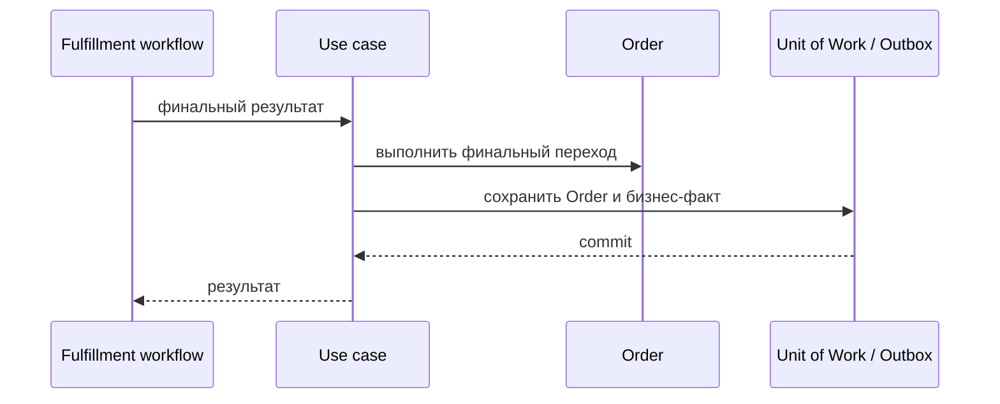

# Complete Order

## Сценарий

- **Тип:** Command.
- **Actor:** Temporal fulfillment workflow.
- **Намерение:** Зафиксировать успешный итог после выполнения всех необходимых условий.
- **Результат:** `Order` переведён в окончательное успешное состояние.

## Границы

- **Владелец:** `orders/slices/order`.
- **Домен:** `domains/order`.
- **Взаимодействие:** Workflow вызывает сценарий после подтверждённых результатов участвующих контекстов; домен `Order` проверяет допустимость перехода.

## Последовательность

## Реализация

Handler: [`completeorder.go`](completeorder.go), unit-тесты: [`completeorder_test.go`](completeorder_test.go).

- **Вход:** `Input{OrderID}` от Activity (`service` identity внутри `orders`, отдельной authorization нет).
- **Порядок:** `UnitOfWork { Orders.Get → Order.Complete → Save → Outbox.Append(OrderCompleted) }`.
- **Результат:** `completed` или `already_completed` (повтор Activity без второй записи Outbox); `placed`/`cancelled` — `InvalidTransition`.
- **Требования:** FR-113, FR-117; AC-120…AC-122 в OpenSpec change `implement-orders-application-layer`.

## Acceptance

BDD-сценарии размещаются в `acceptance/completeorder.feature` после утверждения acceptance criteria в SDD.

Общий каталог и место сценария в fulfillment process: [Orders use cases](../../../../README.md#use-cases).
