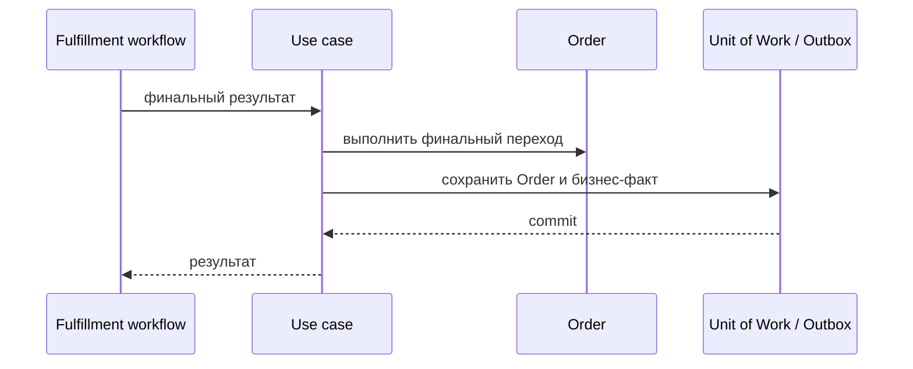

# Fail or Cancel Order

## Сценарий

- **Тип:** Command.
- **Actor:** Temporal fulfillment workflow.
- **Намерение:** Зафиксировать окончательный негативный итог после orchestration и необходимых компенсаций.
- **Результат:** `Order` переведён в соответствующее окончательное состояние с сохранением причины.

## Границы

- **Владелец:** `orders/slices/order`.
- **Домен:** `domains/order`.
- **Взаимодействие:** Workflow координирует компенсации; use case не присваивает правила `restaurants`, `delivery` или `payments`.

## Последовательность

## Реализация

Handler: [`failorcancelorder.go`](failorcancelorder.go), unit-тесты: [`failorcancelorder_test.go`](failorcancelorder_test.go).

- **Вход:** `Input{OrderID, Outcome (cancellation|failure), ReasonCode, DecidedAt}` от Activity.
- **Порядок:** `UnitOfWork { Orders.Get → Order.Cancel(decidedAt, reason) → Save → Outbox.Append(OrderCancelled) }`.
- **Результат:** `cancelled` или `already_cancelled`; `completed` — `InvalidTransition`.
- **Допущение:** Cancellation и Failure используют один Order State `cancelled`, вид итога и код причины сохраняются; отдельный `failed` State не согласован.
- **Требования:** FR-114, FR-117; AC-123…AC-125 в OpenSpec change `implement-orders-application-layer`.

## Acceptance

BDD-сценарии размещаются в `acceptance/failorcancelorder.feature` после утверждения acceptance criteria в SDD.

Общий каталог и место сценария в fulfillment process: [Orders use cases](../../../../README.md#use-cases).
