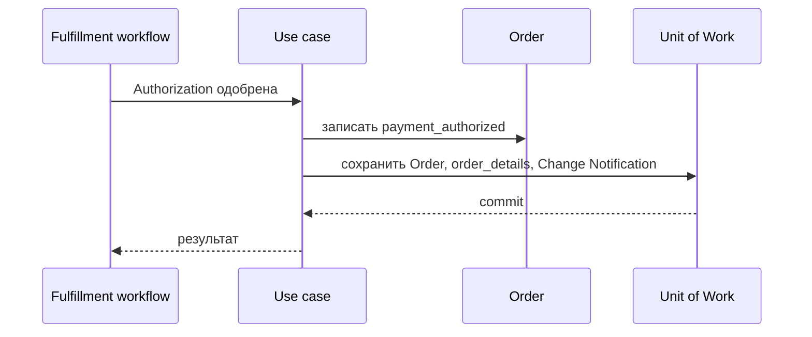

# Record Payment Authorization

## Сценарий

- **Тип:** Command.
- **Actor:** Temporal fulfillment workflow.
- **Намерение:** Зафиксировать в `Order` одобренную Authorization до запроса ресторана.
- **Результат:** У `Order` есть Fulfillment Fact `payment_authorized`; покупатель и флоу-борд видят статус `PAID`.

## Границы

- **Владелец:** `orders/slices/order`.
- **Домен:** `domains/order`.
- **Взаимодействие:** Activity `RecordPaymentAuthorization` вызывает сценарий после одобрения `AuthorizePayment`; следующий шаг маршрута — `RequestRestaurantOrder` ([ADR 5](../../../../../docs/adr/0005-order-fulfillment-orchestration.md)).

## Последовательность

## Реализация

Handler: [`recordpaymentauthorization.go`](recordpaymentauthorization.go), тесты поверх PostgreSQL: [`recordpaymentauthorization_test.go`](recordpaymentauthorization_test.go).

- **Вход:** `Input{OrderID, AuthorizedAt}` от Activity (`service` identity внутри `orders`, отдельной authorization нет). `AuthorizedAt` — время Workflow (`StepInput.DecidedAt`), одинаковое во всех попытках Activity.
- **Порядок:** `UnitOfWork { Orders.Get → Order.RecordPaymentAuthorization(AuthorizedAt) → Save }`; `Save` store процесса пишет `order_details` и Change Notification `orderChanged`.
- **Результат:** `recorded` или `already_recorded` (повтор Activity без изменений); `Order` дальше `paid` — `InvalidTransition`.
- **Outbox:** Integration Event не публикуется — соседним контекстам факт не нужен.
- **Требования:** FR-639, AC-829, AC-830 в OpenSpec change `start-fulfillment-and-pay-before-kitchen`.

Общий каталог и место сценария в fulfillment process: [Orders use cases](../../../../../README.md#use-cases).
