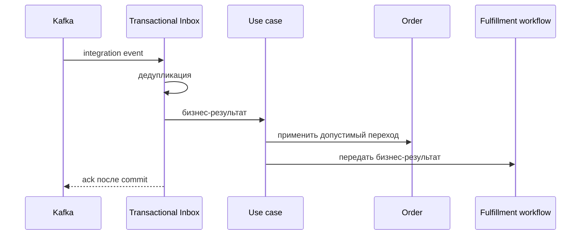

# Confirm Order

## Сценарий

- **Тип:** Command.
- **Actor:** Kafka consumer `orders`.
- **Намерение:** Отразить принятие заказа рестораном.
- **Результат:** `Order` подтверждён не более одного раза; fulfillment workflow может продолжиться.

## Границы

- **Владелец:** `orders/slices/order`.
- **Домен:** `domains/order`.
- **Взаимодействие:** Принимает integration event от `restaurants` через Transactional Inbox и передаёт бизнес-результат workflow.

## Последовательность

## Реализация

Handler: [`confirm.go`](confirm.go), сценарии: [`acceptance_test.go`](acceptance_test.go), остальные случаи: [`confirmorder_test.go`](confirmorder_test.go).

- **Поведение:** `Input{EventID, OrderID, OccurredAt, ExpectedReadyAt}` → `Order.Confirm()`: `placed`/`paid → confirmed` (из более поздних states — только факт в журнал), затем `Order.ExpectReadyAt` — срок готовности ресторана (пустой — не назван, FR-611); `confirmed` — уже применено, срок не меняется.
- **Порты:** `application.UnitOfWork`, `application.Inbox`, `order.Repository`, `fulfillment.Notifier`; поток входящего сигнала — [`fulfillment`](../../fulfillment/README.md#поток-входящего-сигнала).
- **Inbox consumer:** `orders.confirmorder`; повтор `event_id` даёт outcome `duplicate` и повторное уведомление workflow с тем же `event_id`.
- **Outcomes:** `applied`, `already_applied` (повтор шага под новым `event_id`), `ignored_late` (`Order` в `completed`/`cancelled`, `event_id` фиксируется), `duplicate`. Закрытый workflow не является ошибкой (`WorkflowNotified=false`); прочая ошибка уведомления возвращается, чтобы событие было доставлено повторно.
- **Outbox:** не пишется — исходящее Integration Event для этого сценария не определено.
- **Требования:** FR-104, FR-105, FR-109, FR-110; AC-106…AC-108, AC-112…AC-114 в OpenSpec change `implement-orders-application-layer`.
- **`.feature`:** сценарии `@AC-001` и `@AC-003` исполняются `godog` под `go test` против PostgreSQL (testcontainers).

## Acceptance

Executable-сценарии: [`confirm.feature`](acceptance/confirm.feature).

Общий каталог и место сценария в fulfillment process: [Orders use cases](../../../../../README.md#use-cases).
