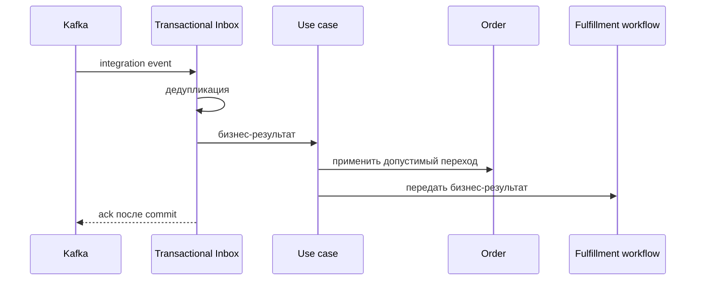

# Reject Order

## Сценарий

- **Тип:** Command.
- **Actor:** Kafka consumer `orders`.
- **Намерение:** Отразить отказ ресторана принять `Kitchen Order`.
- **Результат:** Отказ и доступная причина сохранены не более одного раза; workflow получил бизнес-результат.

## Границы

- **Владелец:** `orders/slices/order`.
- **Домен:** `domains/order`.
- **Взаимодействие:** Принимает integration event от `restaurants` через Transactional Inbox.

## Последовательность

## Реализация

Handler: [`rejectorder.go`](rejectorder.go), unit-тесты: [`rejectorder_test.go`](rejectorder_test.go).

- **Поведение:** `Input{EventID, OrderID, OccurredAt, Reason}` → `Order.RecordRestaurantRejection`: переход в `rejected`; `cancelled` и код причины фиксирует `failorcancelorder`.
- **Порты:** `application.UnitOfWork`, `application.Inbox`, `order.Repository`, `fulfillment.Notifier`; поток входящего сигнала — [`fulfillment`](../../fulfillment/README.md#поток-входящего-сигнала).
- **Inbox consumer:** `orders.rejectorder`; повтор `event_id` даёт outcome `duplicate` и повторное уведомление workflow с тем же `event_id`.
- **Outcomes:** `applied`, `already_applied` (повтор шага под новым `event_id`), `ignored_late` (`Order` в `completed`/`cancelled`, `event_id` фиксируется), `duplicate`. Закрытый workflow не является ошибкой (`WorkflowNotified=false`); прочая ошибка уведомления возвращается, чтобы событие было доставлено повторно.
- **Outbox:** не пишется — исходящее Integration Event для этого сценария не определено.
- **Требования:** FR-104, FR-106, FR-109, FR-110; AC-106, AC-107, AC-109, AC-112…AC-114 в OpenSpec change `implement-orders-application-layer`.

## Acceptance

BDD-сценарии размещаются в `acceptance/rejectorder.feature` после утверждения acceptance criteria в SDD.

Общий каталог и место сценария в fulfillment process: [Orders use cases](../../../../../README.md#use-cases).
