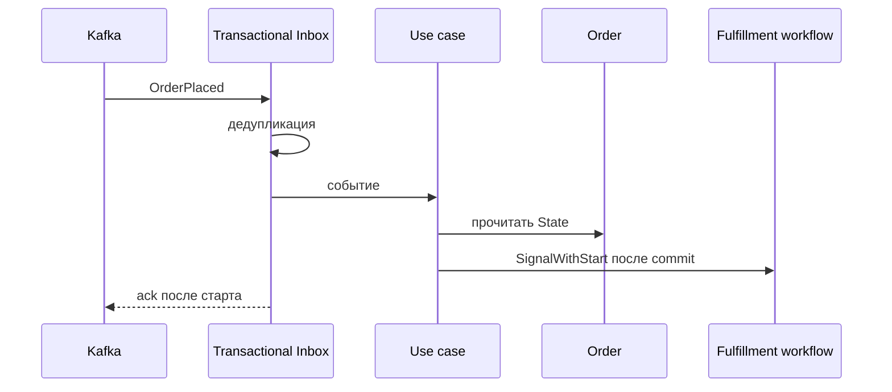

# Start Fulfillment

## Сценарий

- **Тип:** Command.
- **Actor:** Kafka consumer `orders`.
- **Намерение:** Запустить Order Fulfillment Workflow по собственному `OrderPlaced`.
- **Результат:** У незавершённого `Order` есть workflow `order:<order_id>`, получивший `OrderPlaced`; сбой между commit заказа и стартом не теряет процесс.

## Границы

- **Владелец:** `orders/slices/order`.
- **Домен:** `domains/order` (только чтение State).
- **Взаимодействие:** Принимает `nomnom.orders.v1.OrderPlaced` из `orders.v1.order-events` через Transactional Inbox и запускает workflow ([ADR 5](../../../../../docs/adr/0005-order-fulfillment-orchestration.md)). Это единственный путь старта: Place Order Temporal не вызывает.

## Последовательность

## Реализация

Handler: [`startfulfillment.go`](startfulfillment.go), тесты поверх PostgreSQL: [`startfulfillment_test.go`](startfulfillment_test.go).

- **Поведение:** `Input{EventID, OrderID, OccurredAt}` → `application.AcceptOnce` (Inbox + чтение `Order` в одной UoW) → после commit `fulfillment.Starter.Start` с `order_id`, `event_id` и моментом события.
- **Inbox consumer:** `orders.startfulfillment`. Дубликат читает `Order` отдельной UoW и снова вызывает старт: так лечится сбой между commit Inbox и стартом.
- **Outcomes:** `applied`, `duplicate`, `ignored_late` — `Order` в `completed` или `cancelled`: старт не вызывается, потому что история закрытого workflow могла уже уйти из namespace, и workflow запустился бы заново.
- **Ошибки:** неизвестный `Order` — not found (permanent); ошибка старта — `ErrDependencyUnavailable`, сообщение не подтверждается и доставляется повторно, в DLQ не уходит.
- **Outbox:** не пишется.
- **Требования:** FR-638, AC-819…AC-822, AC-827, AC-828 в OpenSpec change `start-fulfillment-and-pay-before-kitchen`.

Общий каталог и место сценария в fulfillment process: [Orders use cases](../../../../../README.md#use-cases).
