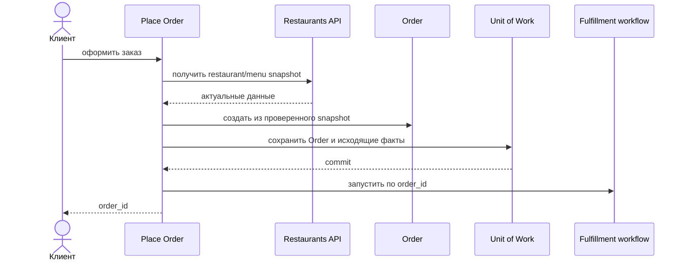

# Place Order

## Сценарий

- **Тип:** Command.
- **Actor:** Клиент.
- **Намерение:** Оформить заказ из выбранных позиций одного ресторана.
- **Результат:** Создан `Order`, зафиксированы состав, цены и snapshot-данные, назначен `order_id`, запущен fulfillment process.

## Границы

- **Владелец:** `orders/slices/order`.
- **Домен:** `domains/order`.
- **Взаимодействие:** Читает сведения ресторана и меню через согласованный API и запускает Temporal fulfillment workflow. Заказ ещё не считается принятым рестораном или оплаченным.

## Последовательность

## Реализация

Handler: [`placeorder.go`](placeorder.go), unit-тесты: [`placeorder_test.go`](placeorder_test.go).

- **Вход:** `Input{Subject, IdempotencyKey, RestaurantID, Items[{MenuItemID, Quantity}], DeliveryAddress}`; subject — `user`, он же Customer.
- **Порядок:** validation → `IdempotencyKeys.FindOrder` → `Catalog.Snapshot` → `IDGenerator` → `order.Place` (`OrderItemsOrderable`) → `Relationships.GrantOrderCustomer` (fail closed) → `UnitOfWork { повторная проверка key, Orders.Add, RememberOrder, Outbox.Append(OrderPlaced) }` → `fulfillment.Starter.Start` после commit.
- **Результат:** `Result{OrderID, Replayed, FulfillmentStarted}`; сбой старта не откатывает `Order`, повтор с тем же key повторяет старт.
- **Допущения:** минимальная/максимальная сумма приходят в catalog snapshot; в `Order` сохраняется только цена позиции; основной старт через `OrderPlaced → Inbox → SignalWithStart` — следующий change.
- **Требования:** FR-100…FR-103; AC-100…AC-105 в OpenSpec change `implement-orders-application-layer`.

## Acceptance

BDD-сценарии размещаются в `acceptance/placeorder.feature` после утверждения acceptance criteria в SDD.

Общий каталог и место сценария в fulfillment process: [Orders use cases](../../../../README.md#use-cases).
