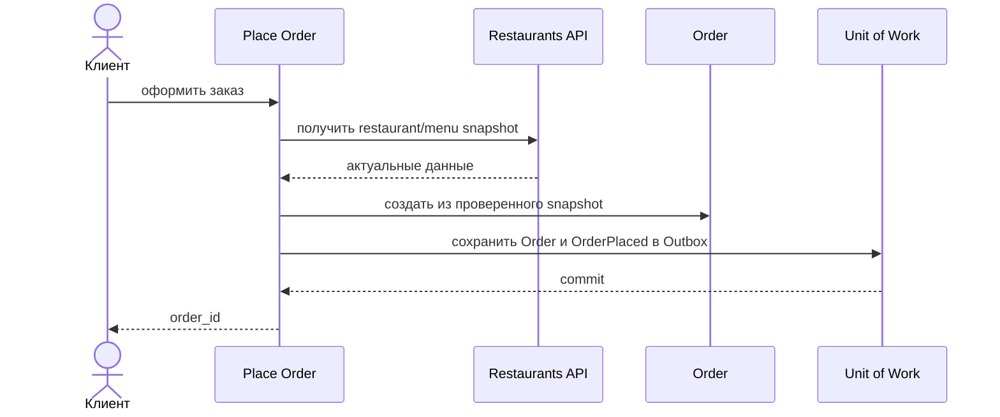

# Place Order

## Сценарий

- **Тип:** Command.
- **Actor:** Клиент.
- **Намерение:** Оформить заказ из выбранных позиций одного ресторана.
- **Результат:** Создан `Order`, зафиксированы состав, цены и snapshot-данные, назначен `order_id`, `OrderPlaced` записан в Outbox; по нему fulfillment process запускает [Start Fulfillment](../startfulfillment/README.md).

## Границы

- **Владелец:** `orders/slices/order`.
- **Домен:** `domains/order`.
- **Взаимодействие:** Читает сведения ресторана и меню через согласованный API; Temporal не вызывает. Заказ ещё не считается принятым рестораном или оплаченным.

## Последовательность

## Реализация

Handler: [`placeorder.go`](placeorder.go), unit-тесты: [`placeorder_test.go`](placeorder_test.go).

- **Вход:** `Input{Subject, IdempotencyKey, RestaurantID, Items[{MenuItemID, Quantity}]}`; subject — `user`, он же Customer.
- **Порядок:** validation → `IdempotencyKeys.FindOrder` → `Catalog.Snapshot` → `IDGenerator` → `order.Place` (`OrderItemsOrderable`) → `UnitOfWork { повторная проверка key, Orders.Add, RememberOrder, RelationshipsChanged, Outbox.Append(OrderPlaced) }`. `order#customer` и `order#restaurant` пишет orders-consumer по `RelationshipsChanged` ([ADR 18](../../../../../../docs/adr/0018-spicedb-for-authorization.md)); до этого Customer читает и отменяет свой заказ по `customer_id` (Get Order, Request Order Cancellation).
- **Конкурентный повтор:** два запроса с одним key могут оба не найти его; `RememberOrder` второго ждёт commit первого на unique index и возвращает `ErrIdempotencyKeyTaken`. Тогда транзакция второго откатывается, key перечитывается после commit, и запрос возвращает Order первого (`Replayed`); если Order не найден — `ErrConcurrencyConflict` (gRPC `ABORTED`, клиент повторяет). Второй ничего не записал: `RelationshipsChanged` откатился с его транзакцией (FR-565, AC-671).
- **Результат:** `Result{OrderID, Replayed}`. Workflow запускает consumer собственного `OrderPlaced` ([Start Fulfillment](../startfulfillment/README.md)); поле `PlaceOrderResponse.fulfillment_started` удалено (`reserved 3`).
- **Market:** `Order.MarketID` берётся только из Restaurant catalog snapshot (`restaurants.GetRestaurant` → `Restaurant.market_id`, [ADR 41](../../../../../../docs/adr/0041-cell-based-architecture-with-control-plane.md)) и не меняется. Пустой или невалидный `market_id` от restaurants — нарушенный контракт соседа (`catalog.ErrInvalidRestaurant`, gRPC `INTERNAL`), а не ввод клиента; Market по умолчанию нет.
- **Допущения:** минимальная/максимальная сумма приходят в catalog snapshot; в `Order` сохраняется только цена позиции.
- **Требования:** FR-100…FR-103; AC-100…AC-105 в OpenSpec change `implement-orders-application-layer`.

## Acceptance

BDD-сценарии размещаются в `acceptance/placeorder.feature` после утверждения acceptance criteria в SDD.

Общий каталог и место сценария в fulfillment process: [Orders use cases](../../../../README.md#use-cases).
