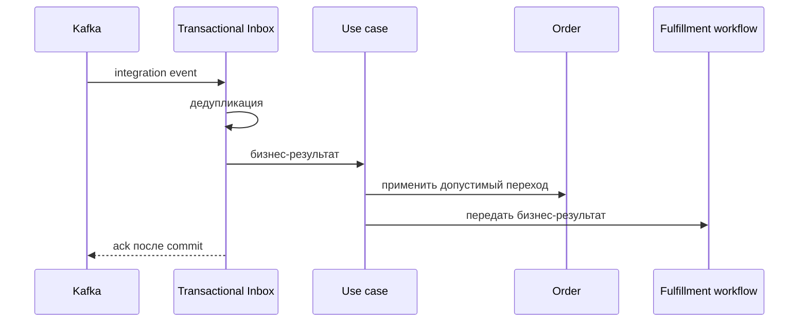

# Record Courier Assignment

## Сценарий

- **Тип:** Command.
- **Actor:** Kafka consumer `orders`.
- **Намерение:** Отразить назначение курьера.
- **Результат:** Назначение отражено в `Order` не более одного раза.

## Границы

- **Владелец:** `orders/slices/order`.
- **Домен:** `domains/order`.
- **Взаимодействие:** Принимает integration event от `delivery` через Transactional Inbox и уведомляет fulfillment workflow.

## Последовательность

## Реализация

Handler: [`recordcourierassignment.go`](recordcourierassignment.go), unit-тесты: [`recordcourierassignment_test.go`](recordcourierassignment_test.go).

- **Поведение:** `Input{EventID, OrderID, OccurredAt}` → `Order.RecordCourierAssignment`: факт `courier_assigned`; Order State не меняется, идентификатор Courier не сохраняется.
- **Порты:** `application.UnitOfWork`, `application.Inbox`, `order.Repository`, `fulfillment.Notifier`; общий поток — [`fulfillment.Reflector`](../fulfillment/README.md).
- **Inbox consumer:** `orders.recordcourierassignment`; повтор `event_id` даёт outcome `duplicate` и повторное уведомление workflow с тем же `event_id`.
- **Outcomes:** `applied`, `already_applied` (повтор факта под новым `event_id`), `ignored_late` (`Order` в `completed`/`cancelled`, `event_id` фиксируется), `duplicate`. Закрытый workflow не является ошибкой (`WorkflowNotified=false`); прочая ошибка уведомления возвращается, чтобы событие было доставлено повторно.
- **Outbox:** не пишется — исходящий бизнес-факт для этого сценария не определён.
- **Требования:** FR-104, FR-107, FR-109, FR-110; AC-106, AC-107, AC-110, AC-112…AC-114 в OpenSpec change `implement-orders-application-layer`.
- **`.feature`:** сценарии `@AC-002` проверяются unit-тестами handler на in-memory адаптерах; Gherkin runner (`godog`) пока не подключён.

## Acceptance

Executable-сценарии: [`recordcourierassignment.feature`](acceptance/recordcourierassignment.feature).

Общий каталог и место сценария в fulfillment process: [Orders use cases](../../../../README.md#use-cases).
