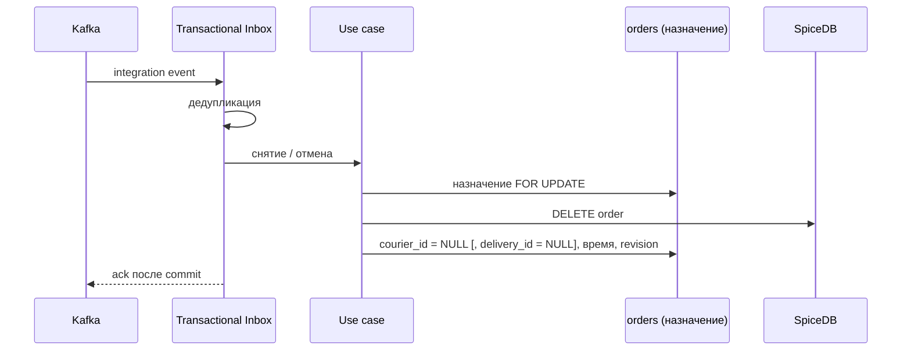

# Record Courier Release

## Сценарий

- **Тип:** Command.
- **Actor:** Kafka consumer `orders`.
- **Намерение:** Отозвать доступ курьера к заказу, когда `delivery` снимает его без замены или отменяет Delivery.
- **Результат:** `order#courier` (и `order#delivery` при отмене) удалены, если событие относится к сохранённому назначению.

## Границы

- **Владелец:** `orders/slices/order`.
- **Домен:** `domains/order` не меняется: снятие курьера и отмена Delivery не являются fulfillment-фактами `Order`.
- **Взаимодействие:** Принимает integration events `CourierUnassignedFromDelivery` и `DeliveryCancelled` от `delivery` через Transactional Inbox; workflow не уведомляется.

## Последовательность

## Реализация

Handler: [`recordcourierrelease.go`](recordcourierrelease.go), unit-тесты: [`recordcourierrelease_test.go`](recordcourierrelease_test.go).

- **Поведение:** `Input{EventID, OrderID, OccurredAt, DeliveryVersion, DeliveryID, CourierID, DeliveryCancelled}`; `DeliveryVersion` — `aggregate_version` envelope. В одном unit of work: `Inbox.Accept`, чтение назначения под row lock, затем `Relationships.ReleaseCourier` для сохранённого курьера и `Assignments.RememberCourierAssignment` с пустым курьером (и Delivery при отмене), временем, версией события и ZedToken.
- **Guard:** порядок задаёт версия Delivery (у Order одна Delivery, каждая транзакция Delivery увеличивает версию), а не `occurred_at` (`DEFAULT now()` — начало транзакции delivery). Событие другой Delivery или с версией ниже сохранённой — `ignored_stale` без изменений, но с Inbox record. Применённое событие снимает сохранённого курьера, даже если называет другого: после этой версии у Delivery нет курьера, а назначение названного старше и будет пропущено. Без сохранённого назначения ничего не удаляется, но снятие запоминается со своей версией (`remembered_ahead`), поэтому более старое `CourierAssignedToDelivery`, обработанное позже, пропускается Record Courier Assignment.
- **Почему не fulfillment-факт:** отмену Delivery запрашивает сам Order Fulfillment workflow (компенсация `CancelDelivery`), снятие курьера возвращает Delivery в поиск; `DeliveryFailed` (после Pickup) обрабатывает Record Delivery Failure. Поэтому `Order` и workflow не меняются, `reason` отмены не используется.
- **Reconciliation:** `NULL` в `courier_id`/`delivery_id` — отсутствующая relation; остаток в SpiceDB удаляется как orphan после grace.
- **Порты:** `application.UnitOfWork`, `application.Inbox`, `recordcourierassignment.Assignments`, `Relationships`.
- **Inbox consumer:** `orders.recordcourierrelease`; повтор `event_id` даёт outcome `duplicate`.
- **Outcomes:** `released`, `remembered_ahead`, `ignored_stale`, `duplicate`. Ошибка SpiceDB откатывает Inbox record, и redelivery повторяет событие.
- **Outbox:** не пишется.
- **Требования:** FR-476, FR-477, AC-534…AC-538 в OpenSpec change `add-order-command-rpcs-and-relationships`; FR-564, AC-669, AC-670 в change `harden-courier-relationship-ordering`.
- **`.feature`:** сценарии проверяются unit-тестами handler на in-memory адаптерах; Gherkin runner (`godog`) пока не подключён.

## Acceptance

Executable-сценарии: [`recordcourierrelease.feature`](acceptance/recordcourierrelease.feature).

Общий каталог: [Orders use cases](../../../../README.md#use-cases).
