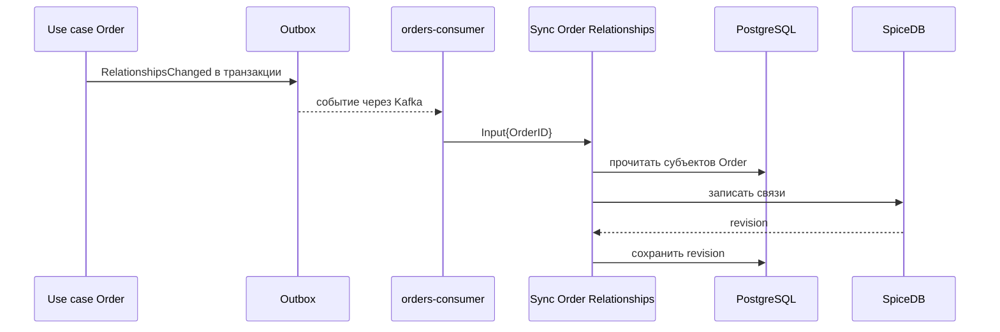

# Sync Order Relationships

## Сценарий

- **Тип:** Command.
- **Actor:** `orders-consumer` по событию `RelationshipsChanged`.
- **Намерение:** Привести связи Order в SpiceDB (`order#customer`, `order#restaurant`, `order#delivery`) к его текущему состоянию в PostgreSQL.
- **Результат:** Связи записаны, их revision сохранена рядом с Order.

## Границы

- **Владелец:** `orders/slices/order`.
- **Домен:** `domains/order`.
- **Взаимодействие:** Use cases, меняющие субъектов Order, не пишут в SpiceDB напрямую: они кладут `RelationshipsChanged` в Outbox своей транзакции. Синхронизация читает состояние, а не событие, поэтому повторное, опоздавшее или переотправленное событие приводит к тем же связям (ADR 18).

## Последовательность

## Реализация

Handler: [`syncrelationships.go`](syncrelationships.go).

- **Вход:** `Input{OrderID}`; результат — `Result{Revision}`.
- **Порты:** `Reader`, `Relationships`, `Revisions`, `Changes`; чтение и сохранение revision идут в одной Unit of Work.

Общий каталог: [Orders README](../../../../README.md).
