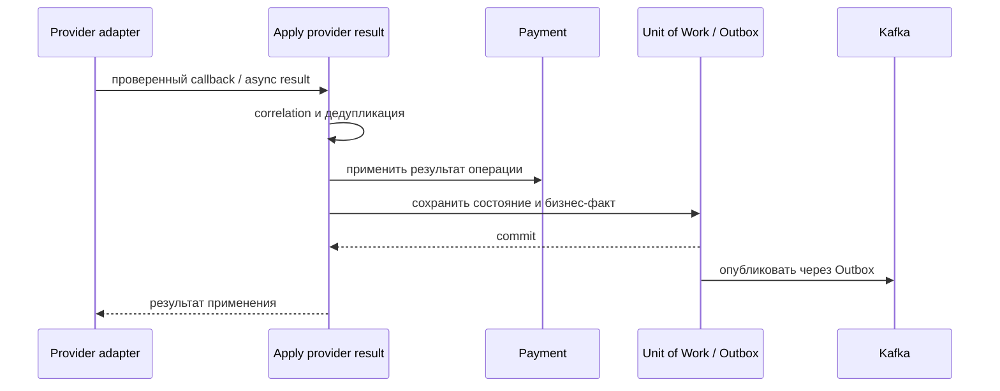

# Apply Provider Callback

## Сценарий

- **Тип:** Command.
- **Actor:** Payment provider.
- **Намерение:** Идемпотентно применить webhook/callback к известной операции.
- **Результат:** Состояние `Payment` или операции обновлено не более одного раза; бизнес-результат опубликован при изменении.

## Границы

- **Владелец:** `payments/slices/payment`.
- **Домен:** `domains/payment`.
- **Взаимодействие:** Инфраструктура проверяет подлинность callback; use case выполняет отдельную дедупликацию provider message.

## Последовательность

## Реализация

Handler `ApplyProviderCallbackHandler` в [`handler.py`](handler.py), требования FR-409, FR-414 change [`implement-payments-application-layer`](../../../../../../openspec/changes/implement-payments-application-layer/). Регистрация `provider_message_id` (порт `ProviderMessageInbox`) и применение результата к операции по `operation_id` выполняются в одной Unit of Work; повторный message — no-op, ошибка откатывает регистрацию.

## Acceptance

BDD-сценарии размещаются в `acceptance/apply_provider_callback.feature` после утверждения acceptance criteria в SDD.

Общий каталог: [Payments use cases](../../../../README.md#use-cases).

