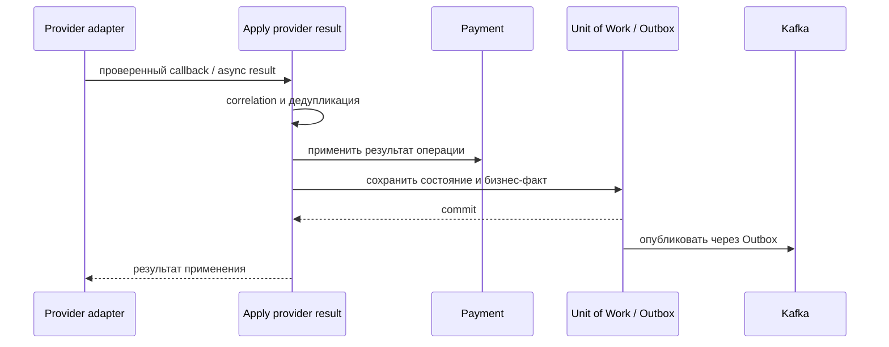

# Apply Provider Operation Result

## Сценарий

- **Тип:** Command.
- **Actor:** Асинхронный adapter payment provider.
- **Намерение:** Применить результат операции, полученный вне исходного запроса.
- **Результат:** Результат сопоставлен с локальной операцией и применён не более одного раза.

## Границы

- **Владелец:** `payments/slices/payment`.
- **Домен:** `domains/payment`.
- **Взаимодействие:** Использует correlation и idempotency provider operation, затем записывает бизнес-факт в Outbox.

## Последовательность

## Реализация

Handler `ApplyProviderOperationResultHandler` в [`handler.py`](handler.py), требования FR-410, FR-414 change [`implement-payments-application-layer`](../../../../../../openspec/changes/archive/2026-10-25-implement-payments-application-layer/). Совпадающий с зафиксированным результат — no-op, противоречащий — `ProviderResultConflictError` без изменений.

## Acceptance

BDD-сценарии размещаются в `acceptance/apply_provider_operation_result.feature` после утверждения acceptance criteria в SDD.

Общий каталог: [Payments use cases](../../../../README.md#use-cases).

