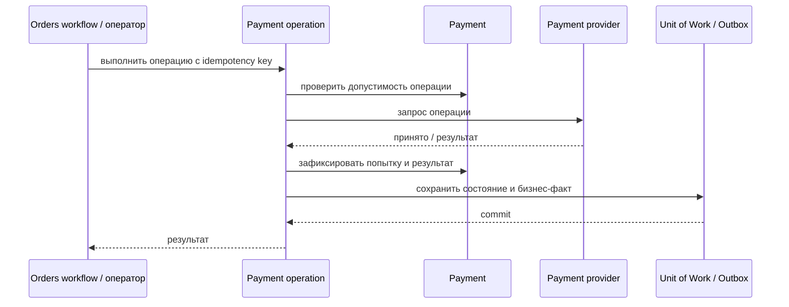

# Authorize Payment

## Сценарий

- **Тип:** Command.
- **Actor:** Fulfillment process `orders`.
- **Намерение:** Зарезервировать сумму для последующего Capture.
- **Результат:** Authorization успешно зафиксирована либо сохранён её отказ.

## Границы

- **Владелец:** `payments/slices/payment`.
- **Домен:** `domains/payment`.
- **Взаимодействие:** Вызывает payment provider с обязательным idempotency key и записывает результат через Outbox.

## Последовательность

## Реализация

Handler `AuthorizePaymentHandler` в [`handler.py`](handler.py), требования FR-401…FR-403, FR-407, FR-408, FR-411, FR-414 change [`implement-payments-application-layer`](../../../../../../openspec/changes/archive/2026-10-25-implement-payments-application-layer/). Общий поток `operation_flow`: pending `Payment Operation` по idempotency key → provider call вне транзакции → результат, `Payment` и Outbox в одной Unit of Work. Отказ переводит `Payment` в `failed`. Момент вызова определяет оркестратор `orders`.

## Acceptance

BDD-сценарии размещаются в `acceptance/authorize_payment.feature` после утверждения acceptance criteria в SDD.

Общий каталог: [Payments use cases](../../../../README.md#use-cases).

