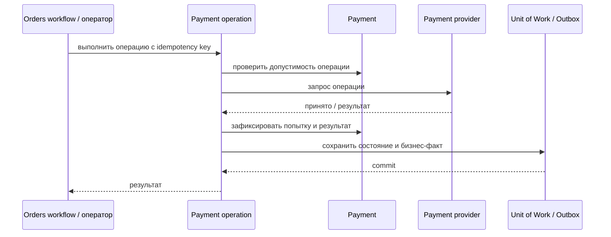

# Cancel Authorization

## Сценарий

- **Тип:** Command.
- **Actor:** Fulfillment process `orders`.
- **Намерение:** Освободить авторизованные средства, когда Capture больше не требуется.
- **Результат:** Authorization отменена либо сохранён отказ provider.

## Границы

- **Владелец:** `payments/slices/payment`.
- **Домен:** `domains/payment`.
- **Взаимодействие:** Вызывается compensation Activity, идемпотентно обращается к provider и не отменяет `Order`.

## Последовательность

## Реализация

Handler `CancelAuthorizationHandler` в [`handler.py`](handler.py), требования FR-402, FR-403, FR-405, FR-407, FR-411, FR-414 change [`implement-payments-application-layer`](../../../../../../openspec/changes/implement-payments-application-layer/). Общий поток `operation_flow`; успех возвращает `Payment` в `pending` без `Provider Reference`, отказ оставляет `authorized`. `Order` не изменяется.

## Acceptance

BDD-сценарии размещаются в `acceptance/cancel_authorization.feature` после утверждения acceptance criteria в SDD.

Общий каталог: [Payments use cases](../../../../README.md#use-cases).

