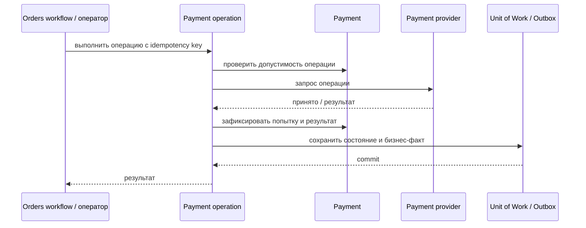

# Capture Payment

## Сценарий

- **Тип:** Command.
- **Actor:** Fulfillment process `orders`.
- **Намерение:** Списать ранее авторизованную сумму.
- **Результат:** Capture успешно зафиксирован либо сохранён его отказ.

## Границы

- **Владелец:** `payments/slices/payment`.
- **Домен:** `domains/payment`.
- **Взаимодействие:** Вызывает provider идемпотентно; текущая минимальная модель поддерживает полный Capture.

## Последовательность

## Реализация

Handler `CapturePaymentHandler` в [`handler.py`](handler.py), требования FR-402…FR-404, FR-407, FR-411, FR-414 change [`implement-payments-application-layer`](../../../../../../openspec/changes/archive/2026-10-25-implement-payments-application-layer/). Полный Capture через общий поток `operation_flow`. Отказ provider сохраняется в `Payment Operation`, `Payment` остаётся `authorized`. Policy `PaymentCapturable` не применяется, пока не определён срок Authorization.

## Acceptance

BDD-сценарии размещаются в `acceptance/capture.feature` после утверждения acceptance criteria в SDD.

Общий каталог: [Payments use cases](../../../../README.md#use-cases).

