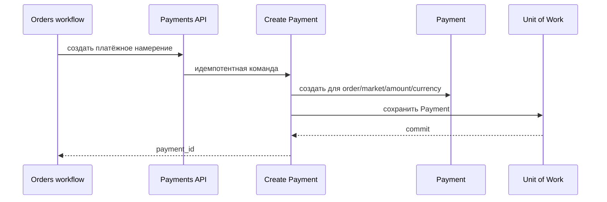

# Create Payment

## Сценарий

- **Тип:** Command.
- **Actor:** Fulfillment process `orders`.
- **Намерение:** Создать локальное платёжное намерение для заказа.
- **Результат:** Идемпотентно создан `Payment`, связанный с заказом, его Market, суммой и валютой.

## Границы

- **Владелец:** `payments/slices/payment`.
- **Домен:** `domains/payment`.
- **Взаимодействие:** Вызывается через API `payments` и не определяет жизненный цикл `Order`.

## Последовательность

## Реализация

Handler `CreatePaymentHandler` в [`handler.py`](handler.py), требования FR-400, FR-411 change [`implement-payments-application-layer`](../../../../../../openspec/changes/archive/2026-10-25-implement-payments-application-layer/). Естественный ключ идемпотентности — `order_id`: повтор с теми же Market, суммой и валютой возвращает существующий `Payment`, с другими — `PaymentAlreadyExistsError`. `market_id` — Market заказа ([ADR 41](../../../../../../docs/adr/0041-cell-based-architecture-with-control-plane.md)), обязателен и неизменяем: пустой или не slug `^[a-z][a-z0-9-]{1,31}$` — `InvalidPaymentRequestError` до проверки прав. Одиночная запись без Unit of Work; provider не вызывается, факт не публикуется.

## Acceptance

BDD-сценарии размещаются в `acceptance/create_payment.feature` после утверждения acceptance criteria в SDD.

Общий каталог: [Payments use cases](../../../../README.md#use-cases).

