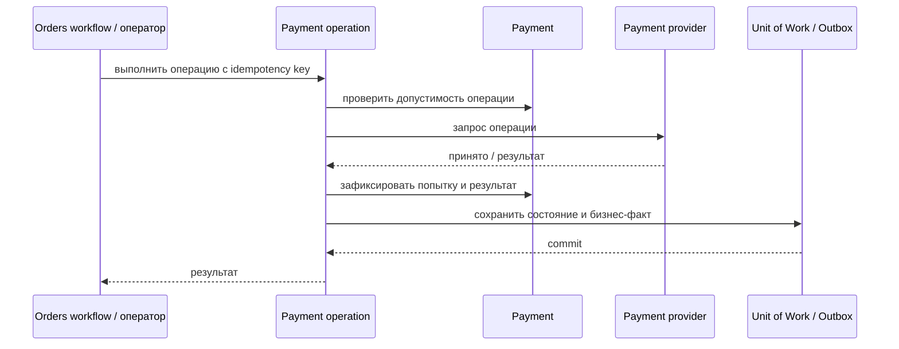

# Refund Payment

## Сценарий

- **Тип:** Command.
- **Actor:** Fulfillment process `orders` или авторизованный оператор.
- **Намерение:** Вернуть поддерживаемую сумму ранее выполненного Capture.
- **Результат:** Refund успешно зафиксирован либо сохранён его отказ.

## Границы

- **Владелец:** `payments/slices/payment`.
- **Домен:** `domains/payment`.
- **Взаимодействие:** Идемпотентно обращается к provider; минимальная модель поддерживает полный Refund, partial refund требует отдельного решения.

## Последовательность

## Реализация

Handler `RefundPaymentHandler` в [`handler.py`](handler.py), требования FR-402, FR-403, FR-406, FR-407, FR-411, FR-414 change [`implement-payments-application-layer`](../../../../../../openspec/changes/archive/2026-10-25-implement-payments-application-layer/). Только полный Refund через общий поток `operation_flow`; partial refund остаётся открытым продуктовым вопросом. Отказ оставляет `Payment` в `captured`. Policy `PaymentRefundable` не применяется, пока не определён refund window.

## Acceptance

BDD-сценарии размещаются в `acceptance/refund.feature` после утверждения acceptance criteria в SDD.

Общий каталог: [Payments use cases](../../../../README.md#use-cases).

