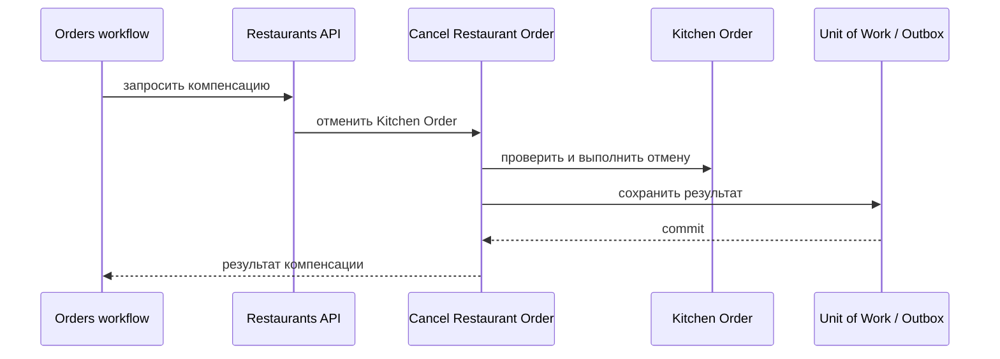

# Cancel Restaurant Order

## Сценарий

- **Тип:** Command.
- **Actor:** Fulfillment process `orders`.
- **Намерение:** Запросить прекращение работы над `Kitchen Order`.
- **Результат:** Заказ ресторана отменён, если стадия и политика это допускают; результат возвращён orchestration.

## Границы

- **Владелец:** `restaurants/slices/kitchenorder`.
- **Домен:** `domains/kitchenorder`.
- **Взаимодействие:** Вызывается compensation Activity через RPC `CancelRestaurantOrder` (FR-428) и не завершает общий `Order`. Отмена и её повтор — `cancelled = true`; отказ по стадии — `cancelled = false` и `rejection_reason` (например `already_ready`, AC-454), а не gRPC-ошибка.

## Последовательность

## Acceptance

BDD-сценарии размещаются в `acceptance/cancel-restaurant-order.feature` после утверждения acceptance criteria в SDD.

Общий каталог: [Restaurants use cases](../../../../README.md#use-cases).

