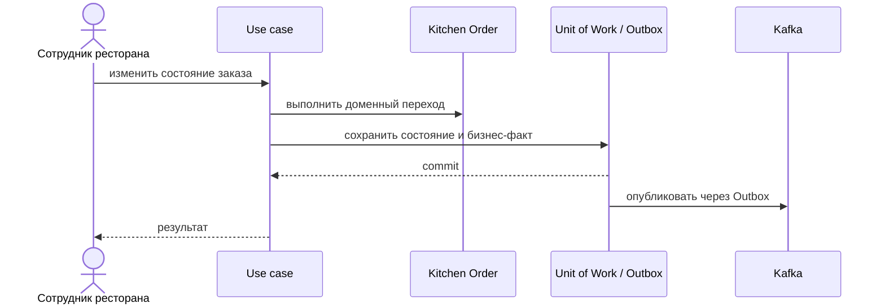

# Accept Order

## Сценарий

- **Тип:** Command.
- **Actor:** Авторизованный сотрудник ресторана.
- **Намерение:** Подтвердить возможность приготовить весь `Kitchen Order`.
- **Результат:** `Kitchen Order` принят; результат доступен `orders`.

## Границы

- **Владелец:** `restaurants/slices/restaurantorder`.
- **Домен:** `domains/restaurantorder`.
- **Взаимодействие:** Проверяет открытость ресторана и доступность позиций, затем записывает бизнес-факт в Outbox.

## Последовательность

## Acceptance

BDD-сценарии размещаются в `acceptance/accept-order.feature` после утверждения acceptance criteria в SDD.

Общий каталог: [Restaurants use cases](../../../../README.md#use-cases).

