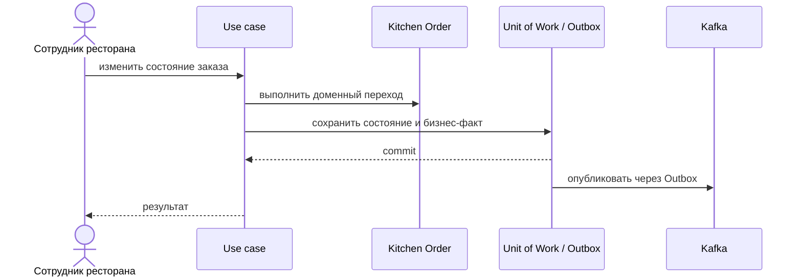

# Accept Order

## Сценарий

- **Тип:** Command.
- **Actor:** Авторизованный сотрудник ресторана.
- **Намерение:** Подтвердить возможность приготовить весь `Kitchen Order`.
- **Результат:** `Kitchen Order` принят; результат доступен `orders`.

## Границы

- **Владелец:** `restaurants/slices/restaurantorder`.
- **Домен:** `domains/restaurantorder`.
- **Взаимодействие:** Проверяет открытость ресторана и доступность позиций, затем записывает бизнес-факт в Outbox.
- **Срок готовности:** необязательный `expected_ready_at` называет кухня; он MUST быть позже момента принятия, иначе `invalid_restaurant_order` (`expected_ready_at_not_later`, gRPC `INVALID_ARGUMENT`). Без него срок считает `ReadyTimeEstimator`. `RestaurantOrderAccepted` несёт `expected_ready_at` (FR-609, AC-769).
- **Заказ без окна** в той же Unit of Work переходит в `QUEUED`; `RestaurantOrderAccepted` несёт `queued_at` — начало длительности Wait Time Statistics (FR-644).
- **Запланированный заказ** переходит в `ACCEPTED` с `expected_ready_at = planned_ready_at` и без `queued_at`: в Kitchen Queue его ставит `orders` через Queue Restaurant Order. Срок от кухни для него — `INVALID_ARGUMENT` (`expected_ready_at_of_scheduled_order`), заказ остаётся в `RECEIVED` (FR-222, AC-922, AC-923).

## Последовательность

## Acceptance

BDD-сценарии размещаются в `acceptance/accept-order.feature` после утверждения acceptance criteria в SDD.

Общий каталог: [Restaurants use cases](../../../../../README.md#use-cases).

