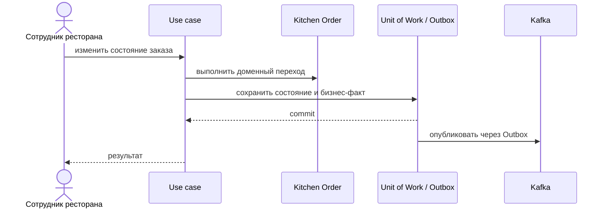

# Reject Order

## Сценарий

- **Тип:** Command.
- **Actor:** Авторизованный сотрудник ресторана.
- **Намерение:** Отказаться от приготовления `Kitchen Order`.
- **Результат:** `Kitchen Order` отклонён; доступная причина сохранена и передана `orders`.

## Границы

- **Владелец:** `restaurants/slices/restaurantorder`.
- **Домен:** `domains/restaurantorder`.
- **Взаимодействие:** Записывает бизнес-факт через Transactional Outbox.

## Последовательность

## Acceptance

BDD-сценарии размещаются в `acceptance/reject.feature` после утверждения acceptance criteria в SDD.

Общий каталог: [Restaurants use cases](../../../../../README.md#use-cases).

