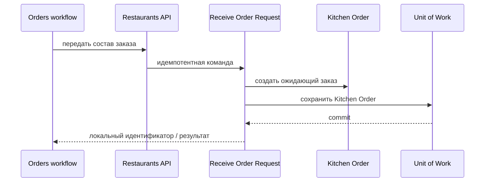

# Receive Order Request

## Сценарий

- **Тип:** Command.
- **Actor:** Fulfillment process `orders`.
- **Намерение:** Передать ресторану состав заказа для решения и приготовления.
- **Результат:** Идемпотентно создан локальный `Kitchen Order` в состоянии ожидания решения.

## Границы

- **Владелец:** `restaurants/slices/restaurantorder`.
- **Домен:** `domains/restaurantorder`.
- **Взаимодействие:** Вызывается Temporal Activity через RPC `ReceiveOrderRequest` (FR-428) и consumer Integration Event `nomnom.orders.v1.OrderPlaced` (`cmd/restaurants-consumer`, Transactional Inbox, `infrastructure/integration/order-placed.ts`); повтор того же состава по `order_id` возвращает `created = false`, поэтому оба пути сходятся к одному Restaurant Order; конфликтующий повтор — `ALREADY_EXISTS` (RPC) или бизнес-исход без Restaurant Order (consumer).

## Последовательность

## Acceptance

BDD-сценарии размещаются в `acceptance/receive-order-request.feature` после утверждения acceptance criteria в SDD.

Общий каталог: [Restaurants use cases](../../../../README.md#use-cases).

