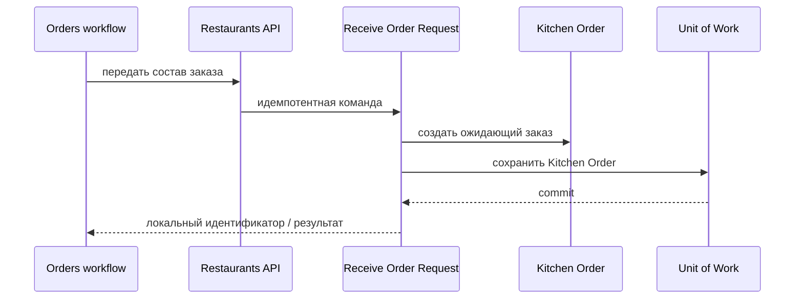

# Receive Order Request

## Сценарий

- **Тип:** Command.
- **Actor:** Fulfillment process `orders`.
- **Намерение:** Передать ресторану состав заказа для решения и приготовления.
- **Результат:** Идемпотентно создан локальный `Kitchen Order` в состоянии ожидания решения, в Market ресторана (ADR 41).

## Границы

- **Владелец:** `restaurants/slices/restaurantorder`.
- **Домен:** `domains/restaurantorder`.
- **Взаимодействие:** Вызывается только Temporal Activity `RequestRestaurantOrder` через RPC `ReceiveOrderRequest` (FR-428) — после одобренной оплаты, поэтому кухня не видит неоплаченных заказов ([ADR 5 orders](../../../../../orders/docs/adr/0005-order-fulfillment-orchestration.md#saga)); `OrderPlaced` Restaurant Order не создаёт. Повтор того же состава по `order_id` возвращает `created = false`; конфликтующий повтор — `ALREADY_EXISTS`. Market Restaurant Order берётся из ресторана (порт `RestaurantMarkets`); RPC Market не передаёт.

## Последовательность

## Acceptance

BDD-сценарии размещаются в `acceptance/receive-order-request.feature` после утверждения acceptance criteria в SDD.

Общий каталог: [Restaurants use cases](../../../../README.md#use-cases).

