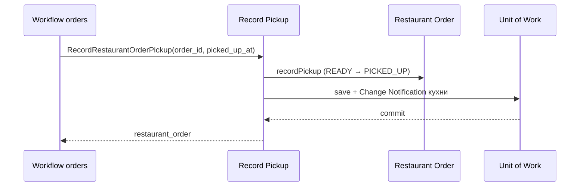

# Record Pickup

## Сценарий

- **Тип:** Command.
- **Actor:** fulfillment workflow `orders` (`service` identity): кухня ничего не знает о доставке, факт Pickup приходит командой.
- **Намерение:** Узнать, что курьер забрал готовый заказ, и снять его с kitchen board.
- **Результат:** `READY` Restaurant Order переходит в `PICKED_UP`; повтор для `PICKED_UP` — no-op.

## Границы

- **Владелец:** `restaurants/slices/restaurantorder`.
- **Домен:** `domains/restaurantorder` — `RestaurantOrder.recordPickup` (`READY × RecordPickup → PICKED_UP`, [FSM](../../../../../../docs/fsm.md)).
- **Взаимодействие:** gRPC `RecordRestaurantOrderPickup` (`order_id`, `picked_up_at`) через internal gateway; только `service` identity `orders`, платформенная проверка до чтения заказа. Вызывает Activity `RecordRestaurantPickup`, когда workflow уже получил и готовность кухни, и `DeliveryPickedUp`. Заказ не в `READY` — `invalid_transition` (`FAILED_PRECONDITION`), неизвестный — `not_found`.

## Последовательность

Общий каталог: [Restaurants use cases](../../../../README.md#use-cases).
