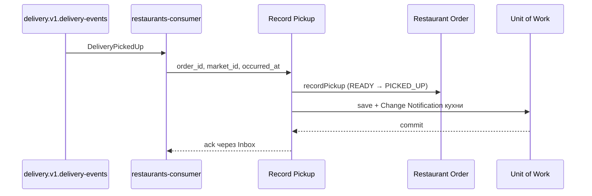

# Record Pickup

## Сценарий

- **Тип:** Command.
- **Actor:** `delivery` — источник факта Pickup (Integration Event `nomnom.delivery.v1.DeliveryPickedUp`).
- **Намерение:** Узнать, что курьер забрал готовый заказ, и снять его с kitchen board.
- **Результат:** `READY` Restaurant Order переходит в `PICKED_UP`; повтор для `PICKED_UP` — no-op.

## Границы

- **Владелец:** `restaurants/slices/restaurantorder`.
- **Домен:** `domains/restaurantorder` — `RestaurantOrder.recordPickup` (`READY × RecordPickup → PICKED_UP`, [FSM](../../../../../../docs/fsm.md)).
- **Взаимодействие:** Вызывается только consumer `DeliveryPickedUp` (`cmd/restaurants-consumer`, Transactional Inbox `restaurants.delivery-picked-up`, `infrastructure/integration/delivery-picked-up.ts`); subject — `service:delivery`, порт `PickupWitnessAccess`. Факт `RestaurantOrderPickedUp` локальный: Integration Event не публикуется. Сохранение пишет Change Notification кухни (ADR 36), поэтому kitchen board обновляется подпиской. Заказ ищется по `order_id`; неизвестный — `not_found`, Pickup не из `READY` — `invalid_transition` (бизнес-исход consumer); `market_id` события, отличный от Market заказа, — `market_mismatch` (DLQ).

## Последовательность

Общий каталог: [Restaurants use cases](../../../../README.md#use-cases).
