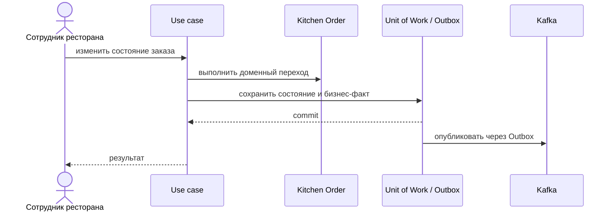

# Start Preparation

## Сценарий

- **Тип:** Command.
- **Actor:** Авторизованный сотрудник ресторана.
- **Намерение:** Взять следующий заказ из Kitchen Queue (Start Next Preparation): кухня называет ресторан и `request_id` попытки, заказ выбирает очередь.
- **Результат:** голова очереди — премиум-заказ или обычный, ждущий дольше базового времени ресторана × `KITCHEN_QUEUE__AGING_FACTOR`, затем остальные обычные, FIFO по `queued_at` внутри класса (порт `KitchenQueueOrdering`, FR-241) — переведена в состояние приготовления свободным поваром на линии из Cook Pool (порт `CookAssigner`, FR-225). Без свободного повара — `NoCookAvailableError`, очередь не меняется. Пустая очередь — пустой результат, не ошибка. Повтор с тем же `request_id` находит начатый заказ (`start_request_id`) и не начинает другой; ответ — по политике повтора.

## Границы

- **Владелец:** `restaurants/slices/restaurantorder`.
- **Домен:** `domains/restaurantorder`.
- **Взаимодействие:** Записывает статусный бизнес-факт через Transactional Outbox.

## Последовательность

## Acceptance

BDD-сценарии размещаются в `acceptance/start-preparation.feature` после утверждения acceptance criteria в SDD.

Общий каталог: [Restaurants use cases](../../../../README.md#use-cases).

