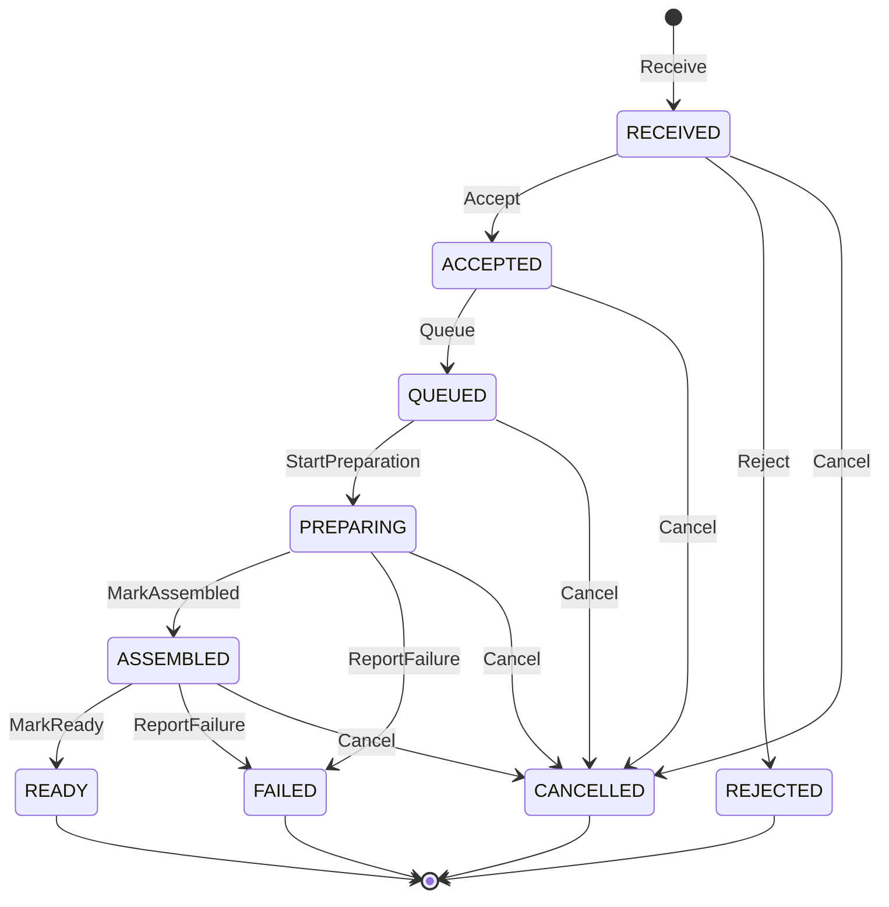

# Finite State Machines

Finite State Machine (FSM) — чистая часть domain model агрегата. Она описывает только допустимое изменение business state:

```text
state + trigger + domain inputs = next state | typed domain error
```

При одинаковых значениях `state`, `trigger` и domain inputs результат всегда одинаков. FSM не выполняет побочных эффектов и не зависит от способа вызова, хранения или наблюдения агрегата.

Архитектурное решение зафиксировано в [ADR 21: Pure FSM Transitions](adr/0021-pure-fsm-transitions.md). Оно согласуется с разделением domain/application/infrastructure из [ADR 6](adr/0006-ddd-structure-inside-vertical-slices.md), локальной транзакционной границей из [ADR 20](adr/0020-unit-of-work-for-local-transactions.md) и оркестрацией заказов из [локального Temporal ADR](../boundaries/orders/docs/adr/0002-use-temporal-to-orchestrate-orders.md).

## Ответственность FSM

FSM владеет:

- текущим business state агрегата;
- набором допустимых triggers;
- guards, использующими только domain model и явно переданные чистые значения;
- вычислением следующего состояния;
- отклонением недопустимых переходов типизированной domain error.

Transition table выражается как данные и является единым источником для transition engine, table-driven тестов и генерации диаграмм или документации. Бизнес-правила переходов не дублируются россыпью `if`/`switch` в handlers, adapters и callbacks. Языковое представление таблицы может различаться, но каждая запись явно задаёт исходное состояние, trigger, guard или безусловное правило и результат.

На один aggregate приходится одна FSM: `Order`, `Delivery` и `Payment` имеют независимые модели состояний. Переход между aggregates выполняется через commands и events, а не через общую FSM. Совпадение названий состояний в разных bounded contexts не создаёт общий тип или общую transition table.

FSM моделирует business state агрегата. Orchestration stage, ожидания, retries, timers и compensation принадлежат Temporal Workflow и не становятся состояниями `Order`. Например, `cancelled` может быть состоянием `Order`, а `waiting_restaurant` и `compensating` — только workflow stages. `version`, используемая для optimistic concurrency агрегата, также находится вне FSM.

## Что находится вне FSM

FSM не знает о существовании:

- Kafka, Outbox и Inbox;
- repositories, Unit of Work, SQL, MongoDB и persistence models;
- gRPC, HTTP, Protobuf и transport codes;
- Temporal Activities, Workflow, start, Signal и Update;
- SpiceDB и authorization;
- OpenTelemetry, logging и metrics;
- filesystem, network, system clock и random;
- DI containers и composition roots;
- callbacks, hooks и event bus библиотеки.

Guards не обращаются к repository, clock или внешнему service. Данные, необходимые для решения, уже находятся в aggregate либо передаются как чистые domain values.

## Specification и вне-state guards

Transition table остаётся единственным источником допустимости trigger по текущему state. Specification не заменяет строку таблицы и не дублирует проверку state.

Переиспользуемое условие вне state — временное окно, сумма, зона, capacity, расписание или лимит — может быть выражено чистой domain Specification. Aggregate method вычисляет её перед trigger либо guard transition table делегирует ей проверку; одно правило вызывается в одном месте.

```text
order.Cancel(now, policy)
  → WithinCancellationWindow(order, now, policy)
  → FSM.Trigger(Cancel)
  → update state
  → domain result
```

Unsatisfied Specification возвращает типизированные reasons, которые aggregate оборачивает в domain error. `InvalidTransition`, `AlreadyInState` и state-based часть `GuardFailed` по-прежнему принадлежат FSM. Specification получает `now` и другие внешние данные значениями и не обращается к clock, repository или infrastructure. Полные правила зафиксированы в [Specification Pattern](specification-pattern.md).

## Transition table и результат

Концептуальная запись таблицы выглядит так:

```text
from_state | trigger | guard | to_state | failure
```

Transition engine сначала находит определённый исход для пары `(state, trigger)`, затем вычисляет guard над domain inputs и возвращает значение результата. Он не выполняет action. Успешный результат содержит как минимум `from`, `trigger` и `to`; aggregate применяет `to` к своему состоянию. При необходимости domain method добавляет к результату бизнес-данные, но не transport или infrastructure instructions.

Ошибки перехода типизированы:

- `InvalidTransition{from, trigger}` — trigger не разрешён из текущего состояния;
- `GuardFailed{reason}` — переход известен, но его чистое domain-условие не выполнено;
- `AlreadyInState{state}` — trigger семантически повторяет уже применённый переход в его целевом состоянии.

FSM строгая: повторный trigger в целевом состоянии не считается успешным переходом. Для таких повторов таблица содержит явный исход `AlreadyInState`, поэтому поведение остаётся полным и проверяемым, а не зависит от скрытого special case engine. Application handler интерпретирует эту ошибку по бизнес-семантике конкретного use case: может превратить идемпотентный повтор или duplicate Signal в no-op либо вернуть ошибку. Infrastructure сопоставляет domain/application error с transport contract, обычно `FAILED_PRECONDITION`; FSM не знает gRPC/HTTP codes и `ErrorInfo`.

## Domain methods и domain events

Публичное поведение агрегата выражается domain methods. Например:

```text
order.Cancel(requestedAt, cancellationPolicy):
  validate method-specific conditions
  policyResult = WithinCancellationWindow(order, requestedAt, cancellationPolicy)
  if unsatisfied: return ErrOrderCannotBeCancelled{reasons}
  result = orderFSM.transition(order.state, Cancel, requestedAt)
  order.state = result.to
  record OrderCancelled as in-memory domain data when this business fact matters
  return domain result
```

Порядок — validate conditions, вычислить применимые вне-state Specifications, вызвать FSM, обновить state и вернуть domain result. Метод не сохраняет aggregate и не публикует сообщения.

Domain events — данные о значимых бизнес-фактах, записанные в памяти агрегата, например `OrderCancelled`. Aggregate предоставляет механизм забора накопленных событий наподобие `PullEvents()`. Application получает события после domain operation, а infrastructure преобразует нужные из них в integration events и сохраняет Outbox в одной локальной транзакции со state.

FSM не создаёт event автоматически на каждый переход. Наличие transition не означает, что появился отдельный бизнес-факт для интеграции. Выбор domain event остаётся явным решением domain method.

Transition callbacks (`OnEnter`, `OnLeave`, `BeforeTransition`, `AfterTransition` и аналоги) не используются для external actions, создания Outbox records, публикации сообщений, persistence, telemetry или запуска Temporal. Предпочтителен явный результат перехода, который обрабатывают aggregate и application layer.

## Application и infrastructure flow

Для защищённого синхронного сценария основной поток выглядит так:

```text
authorize
  → UnitOfWork {
      load aggregate
      → domain method
      → FSM
      → persist aggregate
      → persist Outbox
    }
  → commit
```

В остальных entrypoints сохраняется та же domain operation:

```text
Kafka → Inbox → handler → domain method → FSM
FSM/domain result → application → Outbox → Kafka
Temporal Workflow → Activity → handler → domain method → FSM
Kafka → application → FSM → resulting state → Signal, if the use case requires it
```

Kafka consumer преобразует event payload в Command и чистые domain inputs до вызова domain model. Inbox дедуплицирует transport delivery, но не меняет строгость FSM. Activity также преобразует свой payload в Command и вызывает обычный handler. Workflow не вызывает FSM напрямую и не хранит aggregate state.

Authorization выполняется до domain operation. FSM и guards не вызывают SpiceDB и не принимают authorization decision за application layer. UoW обеспечивает атомарность persistence state, Inbox и Outbox, но transaction, repository и commit не входят в модель перехода.

## Time и identifiers

FSM не читает system clock и не генерирует identifiers или random values. Application получает время через clock abstraction и передаёт его значением, например `order.Cancel(requestedAt)`. Идентификатор создаётся application layer либо domain factory, которой значение передано явно. Зафиксированные входные значения делают переход воспроизводимым и детерминированным.

## Persistence и восстановление

Persistence сохраняет явный domain state как enum/string вместе с остальными данными агрегата. Внутренние структуры, runtime objects и конфигурация FSM-библиотеки не сериализуются.

Восстановление выполняется в направлении:

```text
persisted state → aggregate → FSM restored from the aggregate state
```

Repository adapter отвечает за mapping persistence model ↔ domain model. FSM не загружает и не сохраняет себя. Optimistic concurrency проверяет `version` отдельно от transition table.

## Testing

FSM проверяется полностью in-memory, без Docker, Testcontainers, databases, Kafka, Temporal и mocks внешних зависимостей.

Основной table-driven набор использует форму:

```text
from, trigger, inputs → to | typed error
```

Обязательны:

- позитивные переходы для каждой записи;
- недопустимые переходы с точным `InvalidTransition`;
- строгие повторы с `AlreadyInState`;
- отдельные boundary cases каждого guard с `GuardFailed{reason}`;
- тест полноты: каждая пара из декартова произведения всех `state × trigger` имеет явно определённый исход.

Тест полноты не требует, чтобы каждая пара была успешной: он требует отсутствия неявного поведения. BDD-сценарии проверяют бизнес-смысл, например возможность отмены заказа при заданных условиях, а не внутренний API или callback конкретной FSM-библиотеки.

## Observability

Application/infrastructure наблюдает вызов вокруг чистого перехода и при необходимости записывает:

```text
aggregate_type, from_state, trigger, to_state, result
```

Для ошибки `to_state` отсутствует, а `result` содержит низкокардинальный класс результата. Конкретные identifiers, payloads и причины guards следуют общей privacy/cardinality policy. FSM не импортирует observability SDK, не пишет logs и не изменяет metrics.

## Требования к библиотеке

Допустима библиотека, которая работает как чистый transition engine и позволяет выразить transition table как данные. Её внутренние callbacks, hooks и event bus не используются для orchestration или других side effects. Domain code не должен сохранять внутреннее состояние библиотечного runtime.

Если библиотека скрывает таблицу, требует effectful callbacks или подталкивает к external actions внутри перехода, используется простая собственная реализация над явной таблицей.

## Kitchen / Preparation

Концептуальная FSM aggregate `RestaurantOrder` в `restaurants`. Сценарии, use cases и бизнес-смысл states описаны в [Kitchen](kitchen.md); здесь — только модель переходов. Таблица концептуальная: окончательный набор states, triggers и guards фиксирует отдельная FSM-спецификация вместе с реализацией слайса.

`RestaurantOrder` — один aggregate с одной FSM. `Kitchen Order` — роль того же aggregate в кухонном процессе, а не второй aggregate и не вторая FSM. Её states не совпадают с `Order State` и Workflow Stage `orders` и не импортируются ими.



Terminal states: `READY` (успешное завершение работы кухни), `REJECTED`, `CANCELLED`, `FAILED`. После `READY` Pickup принадлежит `delivery`; нужен ли `restaurants` собственный state передачи заказа — открытый вопрос.

| from_state | trigger | guard | to_state | failure |
| --- | --- | --- | --- | --- |
| `RECEIVED` | `Accept` | Ресторан принимает заказы, все позиции доступны (`RestaurantAcceptingOrders`, `MenuItemAvailable`) | `ACCEPTED` | `GuardFailed{reasons}` |
| `RECEIVED` | `Reject` | — | `REJECTED` | — |
| `RECEIVED` | `Cancel` | — | `CANCELLED` | — |
| `ACCEPTED` | `Queue` | — | `QUEUED` | — |
| `ACCEPTED` | `Cancel` | — | `CANCELLED` | — |
| `QUEUED` | `StartPreparation` | — | `PREPARING` | — |
| `QUEUED` | `ReportDelay` | Новое `expected_ready_at` позже текущего и позже `now` | `QUEUED` | `GuardFailed{NotLater}` |
| `QUEUED` | `Cancel` | — | `CANCELLED` | — |
| `PREPARING` | `ChangeItem` | Переход позиции допустим по таблице Preparation Item | `PREPARING` | Ошибка таблицы позиции |
| `PREPARING` | `MarkAssembled` | Все required items в `READY` (только item-level model) | `ASSEMBLED` | `GuardFailed{RequiredItemsNotPrepared}` |
| `PREPARING` | `ReportDelay` | Как для `QUEUED` | `PREPARING` | `GuardFailed{NotLater}` |
| `PREPARING` | `ReportFailure` | — | `FAILED` | — |
| `PREPARING` | `Cancel` | `RestaurantOrderCancellable`, если policy введена | `CANCELLED` | `GuardFailed{reasons}` |
| `ASSEMBLED` | `MarkReady` | — | `READY` | — |
| `ASSEMBLED` | `ReportDelay` | Как для `QUEUED` | `ASSEMBLED` | `GuardFailed{NotLater}` |
| `ASSEMBLED` | `ReportFailure` | — | `FAILED` | — |
| `ASSEMBLED` | `Cancel` | Как для `PREPARING` | `CANCELLED` | `GuardFailed{reasons}` |

Строгие повторы с явным `AlreadyInState`:

| from_state | trigger | Исход |
| --- | --- | --- |
| `ACCEPTED` | `Accept` | `AlreadyInState{ACCEPTED}` |
| `QUEUED` | `Queue` | `AlreadyInState{QUEUED}` |
| `PREPARING` | `StartPreparation` | `AlreadyInState{PREPARING}` |
| `ASSEMBLED` | `MarkAssembled` | `AlreadyInState{ASSEMBLED}` |
| `READY` | `MarkReady` | `AlreadyInState{READY}` |
| `REJECTED` | `Reject` | `AlreadyInState{REJECTED}` |
| `CANCELLED` | `Cancel` | `AlreadyInState{CANCELLED}` |
| `FAILED` | `ReportFailure` | `AlreadyInState{FAILED}` |

Все остальные пары `state × trigger` дают `InvalidTransition`. В том числе:

- `PREPARING × MarkReady` — заказ не становится Ready, минуя Assembly;
- `ACCEPTED/QUEUED × Reject` — Reject After Acceptance не разрешён до продуктового решения; при решении строки добавляются в таблицу, а не обходятся в handler;
- `QUEUED × Accept` и последующие States — `InvalidTransition`; так как в MVP Queue выполняется в одной UoW с Accept, повтор Accept Order почти всегда встретит `QUEUED`, и UI показывает актуальное состояние заказа;
- `READY × Cancel` — application сопоставляет ошибку с бизнес-результатом `CancellationRejected{ALREADY_READY}`, который Activity `orders` не повторяет как technical failure.

Интерпретация `AlreadyInState` — application layer ([Transition table и результат](#transition-table-и-результат)). Предложение для kitchen board: Start Preparation и Mark Ready for Pickup превращают повтор в успешный no-op без нового Domain Event; Cancel Restaurant Order возвращает сохранённый результат отмены. Политика остаётся предложением до подтверждения продуктом.

Текущие допущения реализации ([design.md change `implement-restaurants-application-layer`](../openspec/changes/implement-restaurants-application-layer/design.md#допущения-по-открытым-продуктовым-вопросам)); продуктовые вопросы остаются открытыми:

- интерпретация повтора Start Preparation и Mark Ready for Pickup — обязательный параметр handler `onRepeat: "succeed-without-event" | "reject"` без значения по умолчанию, выбор в composition root;
- guard `Cancel` из `PREPARING`/`ASSEMBLED` — политика из обязательного параметра handler `cancellationDuringPreparation: "allow" | "reject"` без значения по умолчанию; `reject` даёт `GuardFailed{cancellation_during_preparation_not_allowed}`;
- Reject After Acceptance: строки `ACCEPTED/QUEUED × Reject` не добавлены, исход — `InvalidTransition`;
- Cancel до Receive не доходит до FSM: заказа нет, application возвращает `NotFoundError`, tombstone не вводится.

`ReportDelay` и `ChangeItem` — самостоятельные triggers с target state, равным source. Это не `AlreadyInState`: trigger не повторяет уже применённый переход, а меняет данные aggregate (`expected_ready_at`, State позиции) в разрешённом State заказа. Строки таблицы явно ограничивают, в каких States это допустимо.

### Preparation Item

Если item-level model входит в scope, lifecycle позиции — таблица entity внутри aggregate `RestaurantOrder`, а не FSM отдельного aggregate. Aggregate сначала проверяет order-level строку `PREPARING × ChangeItem`, затем применяет переход позиции; оба результата возвращаются одним domain result.

| from_state | trigger | guard | to_state |
| --- | --- | --- | --- |
| `PENDING` | `Start` | — | `PREPARING` |
| `PENDING` | `Complete` | Позиция не требует приготовления (кандидат: напитки) | `READY` |
| `PREPARING` | `Complete` | — | `READY` |
| `PENDING`, `PREPARING` | `Fail` | — | `FAILED` |
| `FAILED` | `Restart` | — | `PREPARING` |
| `PENDING`, `PREPARING`, `FAILED` | `Exclude` | Согласованное решение по недоступной позиции | `CANCELLED` |

Набор негативных states не окончательный. `FAILED` позиции не переводит заказ в `FAILED` автоматически: решение принимает кухня или согласованная policy. `CANCELLED` позиция перестаёт быть required. Повторы (`READY × Complete`, `PREPARING × Start` и подобные) дают `AlreadyInState`, остальные пары — `InvalidTransition`; тест полноты охватывает обе таблицы.

### Вне-state условия

Capacity кухни, окно отмены во время Preparation и доля потраченных ресурсов — не строки таблицы, а Specifications ([Specification Pattern](specification-pattern.md)). `RestaurantAcceptingOrders` и `MenuItemAvailable` уже существуют; `RestaurantOrderCancellable` — кандидат. Kitchen Queue и её порядок не являются State `RestaurantOrder`: при ручной перестановке порядок становится данными отдельного aggregate, а не новым state.
